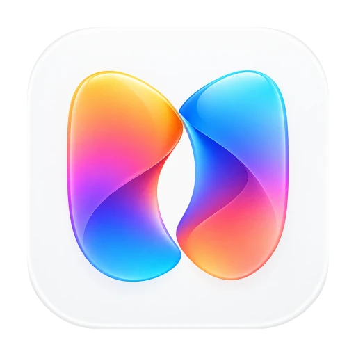
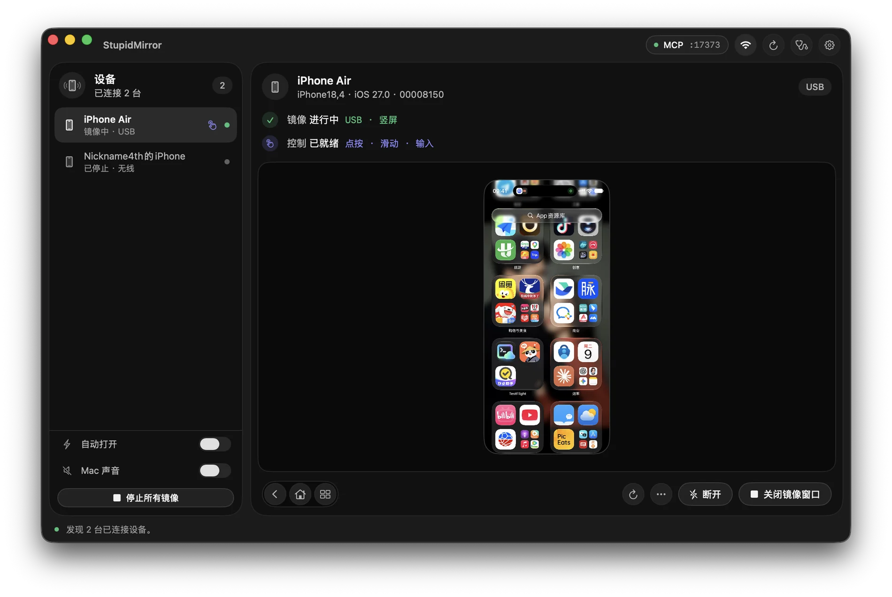

<p align="center">
  
</p>

<h1 align="center">StupidMirror</h1>

<p align="center">
  <strong>Your phone, on your Mac. Your agent, on your phone.</strong><br />
  Native iOS and Android mirroring, device control, and a local MCP server for AI agents.
</p>

<p align="center">
  <a href="Package.swift"></a>
  <a href="https://github.com/LiuTianjie/StupidMirror/actions/workflows/ci.yml"></a>
  <a href="LICENSE"></a>
</p>

<p align="center">
  <a href="https://github.com/LiuTianjie/StupidMirror/releases/latest">Download</a> ·
  <a href="https://liutianjie.github.io/StupidMirror/">Website</a> ·
  <a href="#connect-an-ai-agent">MCP setup</a> ·
  <a href="CHANGELOG.md">Changelog</a> ·
  <a href="README.zh-CN.md">简体中文</a>
</p>

<p align="center">
  
</p>

StupidMirror brings real mobile devices into a native macOS workspace. View an iPhone over USB or Wi-Fi, mirror an Android device through ADB, and interact with either through an explicit control session.

The same workspace is available to AI agents over **MCP**: observe the current screen, locate a target with local OCR or native accessibility, act on the device, and inspect the result. Watch the phone inside Codex with the bundled plugin, or use the native Mac mirror.

**One device can be mirrored and controlled without signing in.** An SM- activation code unlocks simultaneous devices without signing in. The source is available under PolyForm Noncommercial; commercial use requires separate authorization. [License details](#license).

## What makes it useful

- **A native place for your devices.** Menu bar access, a device dashboard, live thumbnails, and independent mirror windows built with SwiftUI and AppKit.
- **Three capture paths.** USB iPhone capture through AVFoundation, wireless iPhone H.264 over the local network, and Android H.264/audio through a pinned scrcpy server.
- **Control when you ask for it.** Tap, swipe, type, press device buttons, switch apps, and launch or terminate apps through native WebDriverAgent on iOS or Appium on Android. Opening a USB or Android mirror does not start a control session.
- **An agent can see what it is doing.** Live frames, Apple Vision OCR, optional accessibility trees, semantic targeting, waits, and assertions share the same device workspace.
- **Automation stays visible.** Agent taps, swipe paths, and selected targets appear on the Mac mirror. These overlays do not alter the phone screen or encoded video.
- **Bring your own AI client.** Built-in connection guides for Codex and Claude Code. StupidMirror itself needs no model API key and runs no embedded model.

## Start with one device

Download the macOS app from [GitHub Releases](https://github.com/LiuTianjie/StupidMirror/releases/latest), move it to Applications, and open it. StupidMirror runs as a menu bar utility.

| Connection | Prepare | Video and audio |
| --- | --- | --- |
| **iPhone · USB** | Trust this Mac; allow Camera access when requested | AVFoundation capture; optional device audio on the Mac |
| **iPhone · Wi-Fi** | Complete **Set Up This iPhone** once over USB (it turns on the phone's Wi-Fi connections); keep both devices on the same LAN | H.264 over SRT through a CoreDevice tunnel, VideoToolbox decoding; wireless audio is not available |
| **Android · ADB** | Android 11+; install Android SDK Platform-Tools on the Mac; enable USB debugging and approve the Mac's key | H.264 video and optional device audio from scrcpy |

**macOS 15+ is required.** Device compatibility can depend on OS versions, trust state, and the available automation runtime. The project remains experimental.

### iPhone over USB

1. Connect the iPhone, unlock it, and accept **Trust This Computer**.
2. Open StupidMirror and grant Camera access from the in-app permission button.
3. Select the discovered device and open its mirror.

Camera permission is needed because macOS exposes the iPhone screen as an AVFoundation capture source; StupidMirror is not using the Mac webcam for this. **Play Device Audio on Mac** is off by default, preserving playback on the iPhone. Turning it on routes USB device audio to the Mac and also requires Microphone permission.

### iPhone over Wi-Fi

Open **Set Up This iPhone** while the phone is connected over USB. The guide checks the device and Apple Development signing identity, builds and installs the screen runner, test-launches it, and enables Wi-Fi connections on the phone (the same switch as Xcode's "Connect via network") before you unplug.

Later sessions reach the phone through the bundled `smtunnel` sidecar: it opens Apple's CoreDevice tunnel over the local network with an in-process network stack and starts the runner through testmanagerd, so no Xcode launcher, administrator password, Local Network prompt, or tap on the phone is involved. Wireless mirroring does not require Camera permission or a ReplayKit Broadcast Extension. It does require this signed device-side runner and Developer Mode on the phone; video setup does not itself enable a control session.

### Android

Install `adb`, enable USB debugging, connect the device, and approve this Mac on the phone. Select the discovered device to start mirroring. Video and audio work independently of the optional Appium control connection.

## Device control

Click **Connect** to start control.

| Platform | Control backend | First connection |
| --- | --- | --- |
| iOS | WebDriverAgent driven directly through the `smtunnel` tunnel (one path for USB and Wi-Fi) | Run **Set Up This iPhone** once over USB: trust the Mac, enable Developer Mode, and let it sign and install the screen agent with an Apple Development identity |
| Android | Appium + UiAutomator2 (the release bundles the Node/Appium runtime for this) | Installs Appium settings/server helper APKs when needed |

Mirror gestures reproduce what the mouse did: a slow drag replays its recorded path and timing, holding still is a long press (so is a right click), a double click is a double tap, trackpad pinch and rotate map to the device's pinch and rotate, and back is the system edge swipe. XCTest can only replay a gesture once the mouse is released, so the finger cannot be followed while the button is held. Advanced settings support a custom Appium endpoint for Android; the default is `http://127.0.0.1:4723`.

## Connect an AI agent

### Codex plugin: connect from the app

1. Install a build that includes the Codex plugin in Applications and open StupidMirror. For a first iPhone connection, connect by USB and complete the app's **iPhone setup guide**. Android needs USB debugging and authorization for this Mac.
2. Open **Settings → MCP Automation** and click **Connect Codex**. The app enables local MCP and installs its bundled plugin using the Codex / ChatGPT desktop app's CLI. No repository clone, Python / Node.js install, token copying or manual configuration is required.
3. Start a new Codex chat, choose **StupidMirror**, and send:

   > Use StupidMirror to show my phone screen inside Codex and read the current page without tapping anything.

4. Codex starts StupidMirror in the background when needed. The live screen uses local WebRTC inside the Codex plugin panel, with device selection, refresh, pause/resume, Home and screenshot-copy controls. No native mirror window opens automatically. Keep the phone connected and unlocked.

**Interaction and annotation:** Enable **操作** to connect device control, then tap or drag the preview. AI actions continue to use the existing MCP tools. **标注** freezes the displayed frame. Drag empty space to draw regions, drag inside a box to move it, or drag its edges and corners to resize. The compact composer stays below the image and supports deletion and undo. Send just the marked screenshot and your note with **⌘ Enter** (or **Ctrl Enter**); plain Enter inserts a newline. Drawing annotations never sends gestures to the phone.

Video uses encrypted local WebRTC without a cloud relay. Hosts without a WebRTC API use native-resolution PNG; WebRTC failures show a reason and a retry button instead of silently switching to screenshots; annotation delivery requires the host’s image-message capability.

Installation errors appear in the app and can be retried. Reconnect the plugin or start a new chat if tools have not loaded. StupidMirror 0.3.1 fixes the `-32603` initialization error caused by experimental client capabilities; restarting Codex does not fix that error in older builds. The embedded panel is named **StupidMirror**. Verify installation, discovery and control separately: `list_devices`, then `observe_screen`, then an authorized action followed by observation.

After updating StupidMirror, click **Update or reinstall plugin** (shown as **Connect Codex** after reopening settings) to refresh the installed copy. Developers can also run `bash scripts/install-codex-plugin.sh` with a compatible Codex CLI, after building with `bash scripts/build-app.sh` and installing the resulting app.

The plugin reuses the app's device engine and automatically reads port and token changes. While MCP is enabled, the app maintains `~/Library/Application Support/StupidMirror/MCP/connection.json` with directory permissions `0700` and file permissions `0600`, removing it when the service stops. Never include this credential file in plugin packages or chat messages.

The installer migrates an existing manual `stupidmirror` MCP entry only when its URL matches this app's current endpoint, retaining a private local recovery copy. Other MCP entries are untouched; a conflicting connection produces an actionable error.

### Manual MCP setup / Claude Code

Expand **Advanced connection settings · Other AI clients**:

1. Open **Settings → MCP** and enable the local MCP server.
2. Choose **Codex** or **Claude Code** in the connection guide.
3. Copy the generated configuration or command into that client. It includes the endpoint, bearer authentication, and setup timeout.
4. Keep StupidMirror open and ask the agent to call `list_devices`.

The server listens only on `http://127.0.0.1:<port>/mcp`. Rotating the bearer token invalidates the previous credential. First-time control setup can be slow, so the guide configures a 240-second tool timeout.

Try an instruction such as:

> List my connected devices, start mirroring my iPhone, and highlight the visible clickable elements without tapping them.

### Observe → act → verify

| Step | Tools | Behavior |
| --- | --- | --- |
| Connect | `list_devices`, `show_screen`, `connect_control` | Discover the target and prepare the required sessions |
| Observe | `observe_screen`, `find_any_element` | Read a live frame; use local OCR and request accessibility only when needed |
| Act | `tap_text`, `tap_element`, `replace_text`, `swipe` | Target observed content or an explicit gesture |
| Verify | `wait_for`, `assert_screen`, `observe_screen` | Check the resulting state |
| Guide | `highlight_clickable_elements`, `highlight_elements`, `clear_highlights` | Draw targets on the Mac mirror without sending input |

<details>
<summary>Targeting and text-input details for agent authors</summary>

- Pass `device_id` when more than one device is present.
- `tap_text` accepts up to 16 candidate labels. By default it runs one local OCR pass, then at most one shared native hierarchy snapshot if needed. `find_any_element` performs the lookup without tapping.
- For screen text, use `observe_screen(include_image=false, include_ocr=true, include_accessibility=false)` first. Request accessibility only when OCR lacks the required semantics or is ambiguous; request an image when visual evidence is needed.
- For icons, canvases, or custom controls, request `include_image: true`, inspect the screenshot, then use an observed coordinate.
- Pass the observation UUID to `tap_element` to reject stale element IDs after the screen changes.
- On iOS, accessibility snapshots can disturb focused text fields. After focusing, use `replace_text` or `clear_text` directly; use `type_text` to append. Replacement and clearing verify the resulting native value.
- Vision OCR supports `fast` and `accurate` modes, defaults to Chinese and English, and runs on demand outside the capture/encoding path.
- Input tools are marked as potentially destructive in MCP metadata because their effect depends on the app currently open on the device.

The [tool definitions](Sources/StupidMirrorApp/StupidMirrorMCPTools.swift) are the authoritative schema.

</details>

## Architecture and privacy

```text
iPhone USB → AVFoundation ─┐
iPhone LAN → H.264 / SRT ──┼→ Capture → native mirror / Vision OCR
Android → ADB / scrcpy ────┘     └→ VideoToolbox H.264 → local WebRTC → Codex panel
Codex → bundled stdio bridge → authenticated localhost MCP → observations/actions
iOS actions → WDA through smtunnel; Android actions → Appium / UiAutomator2
```

Capture, playback, and OCR run locally. StupidMirror does not independently upload mirrored content to a model provider. **An external AI client can receive screenshots and tool results through MCP**; its account, model provider, and data settings determine what happens to that information afterward.

Account sign-in and license validation contact the configured Supabase service. License requests contain account/activation data, not mirrored frames or control input. See the [privacy policy](PRIVACY.md) and [security policy](SECURITY.md).

## Build from source

Use macOS 15+, a Swift 6 toolchain, Go (see the sidecar `go.mod` files), and Node.js 22+ for widget development:

```bash
git clone https://github.com/LiuTianjie/StupidMirror.git
cd StupidMirror
make run
```

```bash
swift build --build-system native # Compile
swift test --build-system native  # Run tests
make app           # Create dist/StupidMirror.app
open dist/StupidMirror.app
```

Before packaging widget changes, run `npm ci --prefix plugins/stupidmirror/ui`, then `npm run build --prefix plugins/stupidmirror/ui` and `npm test --prefix plugins/stupidmirror/ui`. The generated self-contained HTML is bundled in the app. `make app` builds both Go sidecars and the stdio bridge.

For a host Appium installation, use `make setup-appium` and `make run-appium`. Source execution and packaged apps have separate macOS permission identities; grant permissions to the process you are actually running.

The [probe tools](tools/probes/README.md) help inspect discovery, capture, and WDA readiness. `make probe-avfoundation-frame` saves a local frame under the git-ignored `artifacts/` directory.

## Contributing and documentation

Device bugs are most useful with macOS/device OS versions, connection type, reproduction steps, and redacted diagnostics. Changes to capture or control should include real-device verification; a successful Swift build cannot establish device compatibility.

| Document | Scope |
| --- | --- |
| [Contributing](CONTRIBUTING.md) | Development setup and pull request expectations |
| [Codex plugin guide](docs/codex-plugin.md) | Embedded video, manual control, annotation, troubleshooting |
| [Architecture notes](docs/mvp-architecture.md) | Original design and implementation context |
| [Research notes](docs/research.md) | Capture and device-integration research |
| [Release process](RELEASING.md) | Signing, notarization, fixed app identity, and artifact upload |
| [Changelog](CHANGELOG.md) | Release history |
| [Account licensing](LICENSING.md) | Activation, account migration, and licensing infrastructure |

## License

StupidMirror is **source-available** under the [PolyForm Noncommercial License 1.0.0](LICENSE). It permits the noncommercial uses described in that license and is not an OSI-approved open-source license. Commercial use requires separate written authorization; see [commercial licensing](COMMERCIAL-LICENSE.md).

The current app allows one mirror and one control session without activation. To unlock simultaneous devices, enter an `SM-` activation code from the [official store](https://wzyp.cn/item/exords). No sign-in is required. Account sign-in remains optional for restoring an existing account license or binding a Mac license. iTool `IT-` codes are not accepted. Feature activation and commercial authorization are separate matters.

Third-party components retain their own licenses. See [NOTICE](NOTICE).
